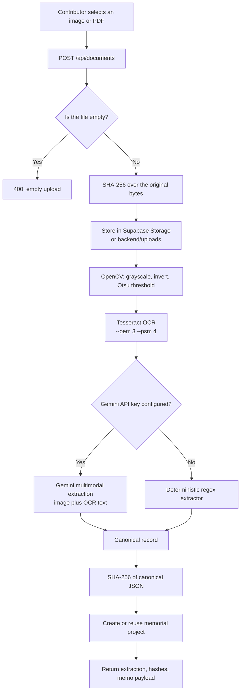
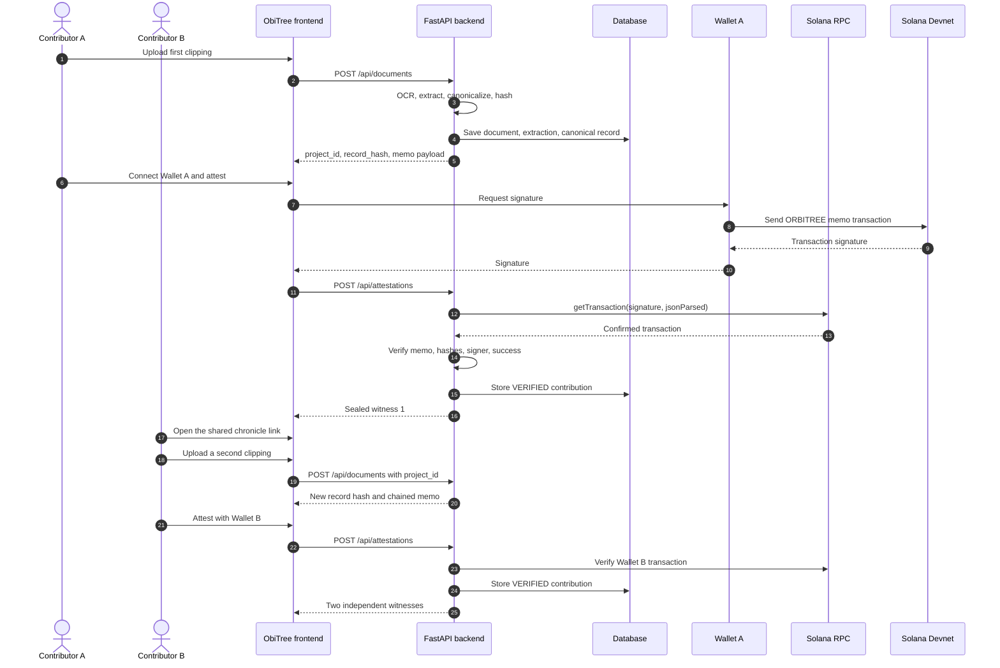
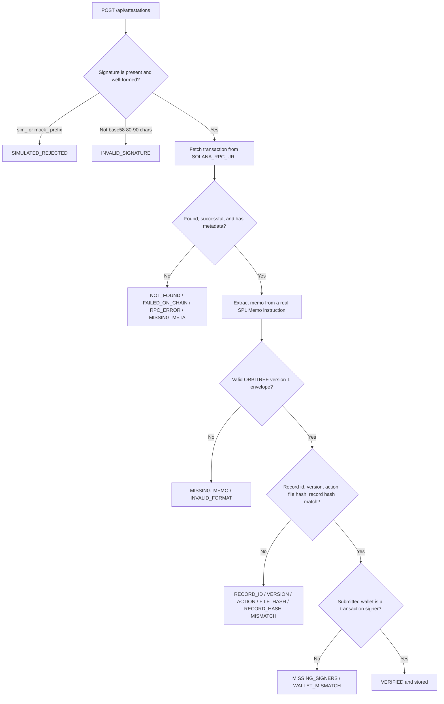
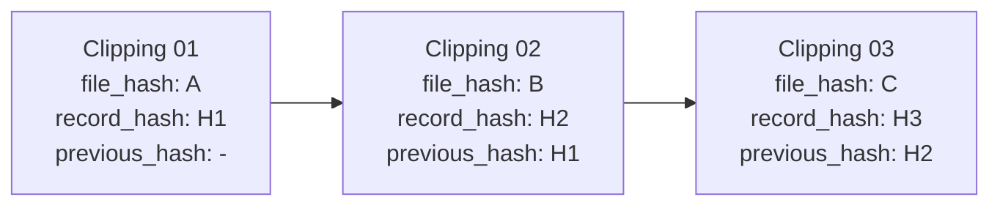
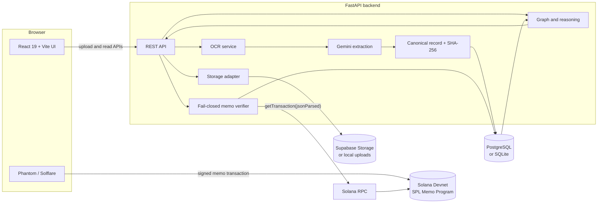
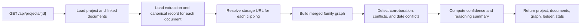
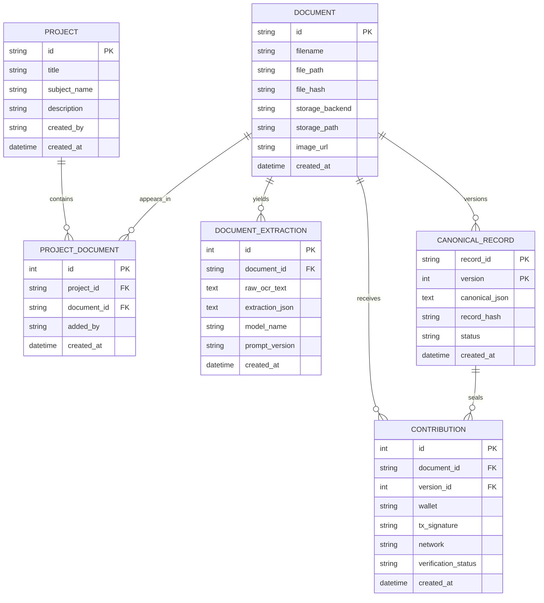

<p align="center">
  
</p>

<h1 align="center">ObiTree</h1>

<p align="center">
  <strong>The family record, sealed on Solana.</strong><br />
  Every obituary is a page. Every page is a block.
</p>

<p align="center">
  <a href="https://obitree.vercel.app/">Live app</a> ·
  <a href="https://obitree.onrender.com/">API</a> ·
  <a href="https://obitree.onrender.com/docs">API docs</a> ·
  <a href="https://github.com/pragga9876/ObiTree">GitHub</a>
</p>

<p align="center">
  
  
  
  
  
</p>

> **Built for the Solana hackathon.** ObiTree uses Solana Devnet as a public
> notary for family-history records: every accepted witness signature is a real
> SPL Memo transaction that can be inspected on Solana Explorer. There is no
> token, no NFT, no custom on-chain program, and no transfer of funds.

---

## Table of contents

- [What is ObiTree?](#what-is-obitree)
- [The problem ObiTree solves](#the-problem-obitree-solves)
- [See it in action](#see-it-in-action)
- [Built for the Solana hackathon](#built-for-the-solana-hackathon)
- [Blockchain and Solana, explained simply](#blockchain-and-solana-explained-simply)
- [Features](#features)
- [How ObiTree works](#how-obitree-works)
- [Architecture diagrams](#architecture-diagrams)
- [Data model](#data-model)
- [The reasoning engine](#the-reasoning-engine)
- [Technology stack](#technology-stack)
- [Repository structure](#repository-structure)
- [Getting started on your own computer](#getting-started-on-your-own-computer)
- [Environment variables](#environment-variables)
- [Wallet setup and a complete two-witness run](#wallet-setup-and-a-complete-two-witness-run)
- [Attestations and on-chain proof](#attestations-and-on-chain-proof)
- [API reference](#api-reference)
- [Canonical records and hashing](#canonical-records-and-hashing)
- [Deployment](#deployment)
- [Troubleshooting](#troubleshooting)
- [Contributing](#contributing)
- [Limitations and roadmap](#limitations-and-roadmap)
- [Documentation index](#documentation-index)
- [License](#license)

---

## What is ObiTree?

ObiTree is a web application that turns old newspaper obituaries and memorial
notices into a structured, source-backed family chronicle.

You upload a photograph, scan, or screenshot of a notice. ObiTree reads the
page, extracts the people named in it and how they are related, and builds a
family tree. Every relationship keeps the exact sentence it came from, the
clipping it belongs to, the wallet that contributed it, and — once attested —
the Solana transaction that sealed it.

A useful analogy:

- **A newspaper archive** preserves the original page.
- **A family scrapbook** connects the people across pages.
- **A notary** witnesses that a record existed in a particular form at a
  particular time.
- **A chain-of-custody log** records who handled the evidence and in what order.

ObiTree is all four in one interface. The visual language is a vintage memorial
supplement; the underlying data model treats each clipping as a block in a
per-chronicle chain.

### At a glance

| Question | Answer |
| --- | --- |
| What do I upload? | A photograph, scan, or screenshot of a notice; PDFs are accepted, but image formats give much better OCR |
| Do I need a wallet to upload? | No. A wallet is only needed to attest |
| What is extracted? | People, relationships, event details, and the exact supporting sentence |
| What goes on-chain? | A memo containing the file hash, canonical record hash, and previous hash |
| Which blockchain? | Solana Devnet, using the official SPL Memo Program |
| What counts as a witness? | A real, confirmed Devnet transaction signed by the submitted wallet |
| Where is the source data? | Supabase Storage in production, local disk in development |
| Where is the structured data? | PostgreSQL in production, SQLite in development |
| Is there a token or NFT? | No |
| Who decides which account is true? | A human reviewer; conflicts are preserved, not auto-resolved |

### What makes it different

Most online family trees ask you to trust whoever edited the tree last. ObiTree
does the opposite:

1. **The original page stays visible.** The extracted record is always shown
   beside the scan, so a reader can check it.
2. **Every claim has provenance.** A relationship is not just an edge; it
   carries a verbatim quote, a source clipping, and a contributing wallet.
3. **Independent contributors are recorded, not merged into an anonymous
   editor.** Two different wallets can attest the same record.
4. **Disagreement is preserved.** If two clippings describe a relationship
   differently, ObiTree marks a conflict and keeps both readings.
5. **The seal is public.** A verified attestation is a real Solana Devnet
   transaction containing the hashes of the page and the extracted record.

### What ObiTree is not

- It is **not a truth oracle**. A blockchain proves that a wallet signed a
  statement; it does not prove that the statement is historically correct.
- It is **not a token project**. No token is minted, sold, or transferred.
- It is **not a replacement for a genealogy archive**. It is a tool for
  reconstructing and preserving records from clippings.
- It is **not currently a production genealogy service**. It is a hackathon
  build that demonstrates a verifiable workflow end to end.

---

## The problem ObiTree solves

Family history is usually reconstructed from fragile, disconnected sources:

- a death notice in one newspaper,
- a memorial notice printed a year later,
- a family announcement with different spellings,
- a photograph of a page that is already fading.

Two things go wrong when those sources are digitized:

1. **The extraction is invisible.** A website shows a tree, but not the
   sentence, page, or contributor behind each branch.
2. **The record is silently editable.** Anyone with database access can change
   a name or relationship and leave no trace of the original.

ObiTree addresses both. It keeps the original file, the raw OCR text, the
structured extraction, and a deterministic canonical record. It then lets
independent wallets attest that exact canonical record by signing its hash in a
Solana memo. If the clipping is re-extracted into a different record, the new
`record_hash` no longer matches the old attestation.

The project deliberately stops short of deciding which conflicting memory is
"correct." It records the disagreement and lets a human review it.

---

## See it in action

| Resource | URL |
| --- | --- |
| Frontend | https://obitree.vercel.app/ |
| Backend API | https://obitree.onrender.com/ |
| Interactive API docs | https://obitree.onrender.com/docs |
| Health check | https://obitree.onrender.com/api/health |
| Source code | https://github.com/pragga9876/ObiTree |

> The deployed instance runs on Solana **Devnet**. Devnet SOL has no monetary
> value and is available from a faucet. Attestations are only recorded as
> `VERIFIED` after the backend fetches and validates a real Devnet transaction.

The repository also contains sample clippings in
[`ObituaryImages/`](ObituaryImages) that you can use to try the extraction
pipeline locally.

---

## Built for the Solana hackathon

ObiTree was built for the Solana hackathon around a simple question:

> What if a family record could be witnessed the way a legal document is
> notarized — cheaply, publicly, and without handing ownership to a platform?

Solana is used as the **witness layer**, not as the database.

### How Solana is incorporated

| Layer | What happens | Where it lives |
| --- | --- | --- |
| Original clipping | The uploaded image or PDF is stored and hashed | Supabase Storage (production) or local disk (development) |
| Extraction | OCR and Gemini produce structured family claims | Backend service |
| Canonical record | Claims are normalized into deterministic JSON and hashed | PostgreSQL (production) or SQLite (development) |
| Witness attestation | A wallet signs a memo containing the record hashes | **Solana Devnet** |
| Verification | The backend fetches the transaction and checks the memo, signer, hashes, and success status | Backend service + Solana RPC |
| Merged family tree | Independent clippings are merged, compared, and explained | Backend service, rendered in the frontend |

### Why Solana?

- **Low fees.** A memo transaction costs a tiny fraction of SOL.
- **Fast confirmation.** Devnet transactions confirm in seconds, which keeps
  the demo workflow responsive.
- **No custom program required.** The official SPL Memo Program is enough to
  put an immutable string on-chain. ObiTree does not deploy or audit its own
  smart contract for this version.
- **Public verifiability.** Anyone can open the transaction in Solana Explorer
  and read the memo and signer without trusting ObiTree's database.

### What is actually on-chain

Only the memo string and the transaction metadata. The memo looks like this:

```text
ORBITREE|1
record: doc_1a2b3c4d
version: 1
action: DOCUMENT_REGISTERED
file_hash: <SHA-256 of the original file>
record_hash: <SHA-256 of the canonical JSON>
previous_hash: <record hash of the previous sealed clipping, or ->
```

The actual image, OCR text, and family tree stay off-chain. Putting a
multi-megabyte scan on-chain would be expensive and unnecessary; the hashes are
enough to prove that a particular file and record existed and were attested.

### What the chain does and does not prove

| The chain proves | The chain does not prove |
| --- | --- |
| A wallet signed this exact memo | That the wallet belongs to a specific human |
| The memo contains these exact hashes | That the obituary's claims are factually true |
| The transaction succeeded on the configured cluster | That two witnesses are independent in real life |
| A record with that hash was attested at that time | That the server's current JSON still matches the hash, or that no other record exists elsewhere |

ObiTree is honest about that boundary. The family graph marks relationships as
corroborated, single-source, or conflicting instead of pretending to produce
absolute truth.

---

## Blockchain and Solana, explained simply

If you are new to blockchain, you only need a handful of ideas to understand
this project.

### Glossary

| Term | Plain-English meaning |
| --- | --- |
| **Hash** | A short fingerprint computed from data. Change one character and the fingerprint changes completely. |
| **SHA-256** | The specific hash function ObiTree uses. It always produces 64 hexadecimal characters. |
| **Blockchain** | A public ledger that many computers maintain together. Once a transaction is confirmed, it is very hard to rewrite. |
| **Solana** | A fast, low-cost blockchain. ObiTree uses its Devnet test network. |
| **Devnet** | A test version of Solana. It uses fake SOL, so experiments cost nothing real. |
| **Wallet** | Software such as Phantom or Solflare that holds a key pair and signs transactions. |
| **Public key / address** | The shareable identifier of a wallet, like an account number. |
| **Transaction** | A signed instruction sent to the blockchain. |
| **Signature** | The unique identifier of a submitted transaction, and proof that the wallet approved it. |
| **SPL Memo Program** | An official Solana program whose only job is to attach a text memo to a transaction. |
| **Attestation** | A witness statement. In ObiTree, a wallet attesting that it saw a specific record hash. |
| **RPC** | The API endpoint the backend uses to read Solana data. |
| **SOL** | Solana's native currency, used to pay network fees. Devnet SOL is free. |

### The mental model

Think of a hash as a wax seal over a document:

1. ObiTree writes the document (the canonical record).
2. It computes a fingerprint (the `record_hash`).
3. A wallet signs a transaction that says, "I saw this fingerprint."
4. Anyone can later recompute the fingerprint and compare it with the one in
   the transaction. If they match, the record has not changed.

Two different wallets doing this create two independent witness statements.
That is the entire blockchain idea behind ObiTree.

---

## Features

### Record reconstruction

- Upload JPG, PNG, or WEBP clippings. PDFs are accepted and stored, but OCR is
  image-oriented, so an image export will produce far better results.
- OpenCV preprocessing followed by Tesseract OCR.
- Gemini multimodal extraction with a deterministic offline fallback.
- Structured family claims: `subject`, `related_person`,
  `relationship_type`, `event`, `event_date`, `event_venue`,
  `event_address`, and verbatim `evidence`.
- Deterministic canonical JSON with two SHA-256 hashes.
- Raw OCR and extraction JSON are inspectable in the UI.

### Multi-contributor chronicles

- Upload without connecting a wallet.
- The first upload creates a memorial project automatically.
- A share link lets another contributor append an independent clipping.
- Every contributor wallet is listed separately.
- Each clipping can receive multiple wallet attestations.
- Clippings are chained through the `previous_hash` field.

### Solana attestations

- Phantom and Solflare support in the browser.
- Devnet-only configuration.
- Real SPL Memo transactions; no simulated signatures accepted.
- Fail-closed verification: any missing or mismatched field is a rejection.
- Failed attempts are stored for audit but never count as verified.
- Direct links to Solana Explorer for every verified transaction.

### Family graph and reasoning

- Merged family tree built from all clippings in a chronicle.
- Name normalization so spelling variants resolve to one person.
- Corroboration based on **distinct file hashes**, not repeated uploads.
- Contradictory relationships and event dates are preserved and flagged.
- An "Editor's reasoning" panel explains every branch.
- A per-chronicle ledger shows the hash chain and witness signatures.
- A provenance panel shows the exact source sentence for every edge.

### Deployment-ready backend

- PostgreSQL in production, SQLite in development.
- Supabase Storage in production, local disk in development.
- Docker image with Tesseract and OpenCV system libraries.
- `/api/health` reports database, storage, and Solana configuration.
- Startup diagnostics warn about missing production configuration or a
  publishable Supabase key.
- CORS allowlist plus an optional regex for Vercel preview deployments.

---

## How ObiTree works

### The short version

1. A contributor uploads a clipping. No wallet is required.
2. The backend stores the file and computes its SHA-256 `file_hash`.
3. OCR reads the page. Gemini converts the text and image into structured
   family claims.
4. The claims are normalized into a deterministic canonical record and hashed
   into a `record_hash`.
5. ObiTree creates (or reuses) a memorial project and returns a memo payload.
6. A wallet signs that memo in a Solana Devnet transaction.
7. The backend fetches the transaction and verifies the memo, the signer, the
   hashes, the network, and the on-chain success status.
8. The verified attestation is stored and the record is marked `ATTESTED`.
9. A second contributor opens the share link, adds another clipping, and
   attests with a different wallet.
10. The backend merges everything into a family graph and explains where each
    branch came from.

### Upload and extraction pipeline



Gemini is given both the OCR text and the original image for image uploads
(PDFs are read through the OCR text only). The image helps it read multi-column
layouts, inverted white-on-black notices, and faded scans. If the API key is
missing, exhausted, or rejected, the deterministic extractor keeps the demo
usable. The chosen extraction model is shown in the UI.

> **Prefer images over PDFs.** The OCR step reads raster images
> (`cv2.imread`, with a Pillow fallback); it does not rasterize PDF pages. A PDF
> is stored, displayed, and hashed, but OCR only sees whatever text Tesseract
> can pull from the raw file, which is often little or nothing. Photograph the
> notice, screenshot it, or export the PDF page as PNG before uploading.

### The two-witness flow



The share link is a hash route:

```text
https://<frontend>/#/memorial/<project-id>
```

Because the route is after `#`, the frontend does not need server-side rewrite
rules on Vercel. The browser loads the same single-page app and the client
reads the project id from the URL.

### Attestation verification

Every check fails closed. A missing field, an RPC failure, an unparseable memo,
or a mismatched hash is a rejection, never a "probably fine."



A failed verification is written to the database as `FAILED` for audit. It is
never counted in the chronicle statistics and never marks the canonical record
as attested.

### The per-chronicle hash chain

Each clipping contributes a block to the chronicle:



`previous_hash` is the `record_hash` of the most recently **verified**
clipping before the current one in the same chronicle. If no earlier clipping
has been sealed yet, it is `-`. Because the memo is generated from current
database state, it can change after an earlier record gets sealed. The frontend
reloads the chronicle after uploads and attestations so the displayed memo
reflects the latest state, but `previous_hash` remains informational chain
metadata: the verifier checks the record id, version, action, file hash, record
hash, and signer, not the previous link.

---

## Architecture diagrams

### System architecture



### Request lifecycle for a chronicle page



The family graph is **derived on read**. It is not stored as a separate table,
so it cannot drift away from the underlying clippings.

---

## Data model

ObiTree uses six relational tables. The schema is created automatically on
startup, and an idempotent migration adds the storage columns to older local
databases.



Key constraints and behaviors:

- `ProjectDocument.document_id` is unique: a clipping belongs to exactly one
  chronicle.
- `CanonicalRecord` is keyed by `(record_id, version)`. This build produces
  version `1`; re-extraction updates that version.
- `Contribution.tx_signature` is unique: the same Solana transaction cannot be
  recorded twice.
- `Contribution.verification_status` is stored as `VERIFIED` or `FAILED`; the
  API reports `UNATTESTED` when a clipping has no contribution yet.
- Deleting a project or clipping is not exposed through the API in this build.

### Canonical record shape

```json
{
  "record_id": "doc_1a2b3c4d",
  "version": 1,
  "extracted_data": [
    {
      "event": "Memorial Service",
      "event_address": "7, Mayfair Road, Kolkata - 700019",
      "event_date": "2026-11-07",
      "event_venue": "PUNJAB BHAWAN",
      "related_person": "Bhawna (Bobby)",
      "relationship_type": "Daughter",
      "subject": "Veena Nayar"
    }
  ],
  "people": [{ "name": "Bhawna (Bobby)" }, { "name": "Veena Nayar" }],
  "claims": [
    {
      "subject": "Bhawna (Bobby)",
      "predicate": "daughter_of",
      "object": "Veena Nayar",
      "evidence": "Bhawna (Bobby) Daughter"
    }
  ]
}
```

The example is illustrative. The actual values depend on the clipping and the
extractor used.

---

## The reasoning engine

The frontend does not receive a pre-baked family tree. The backend builds it
from all clippings in the chronicle on every project request.

### Steps

1. **Normalize names.** Case, punctuation, bracketed nicknames, and noise
   phrases such as "deeply mourned by" are removed or collapsed. This lets
   "Bhawna (Bobby)" and "Bhawna" resolve to the same person.
2. **Filter filings.** A clipping that never names the chronicle subject stays
   in the ledger but is excluded from the merged tree. The response reports
   how many filings were unmerged.
3. **Build edges.** Each claim becomes a directed relationship such as
   `daughter_of`, `son_of`, `spouse_of`, or `grandchild_of`.
4. **Place generations.** The subject is generation `0`. Parents are `-1`,
   children are `+1`, and grandchildren are `+2`.
5. **Detect corroboration.** An edge is corroborated when it appears in two or
   more clippings with **distinct file hashes**. Uploading the same bytes twice
   does not create a second witness.
6. **Detect conflicts.** If the same pair of people is connected by more than
   one family type, or the same relationship is asserted in both directions,
   the edge is marked `conflict`. Different known event dates are also
   reported as date conflicts.
7. **Explain.** Every edge carries a human-readable reasoning sentence, its
   sources, the contributing wallets, and the Solana signatures that sealed
   those sources.

### Edge statuses

| Status | Meaning | Visual treatment |
| --- | --- | --- |
| `corroborated` | Two or more distinct clippings agree | Strong line and agreement marker |
| `single_source` | Only one clipping supports the edge | Lighter line |
| `conflict` | Clippings disagree about the relationship | Flagged edge and review panel |

### Confidence score

The confidence seal is a heuristic, not a scientific probability:

```text
points = 1.0 per corroborated edge
       + 0.6 per single-source edge
       - 0.4 per relationship or date conflict

confidence = max(0, min(99, round(100 * points / number_of_edges)))
```

If there are no edges, confidence is `0`. The score is capped at `99` because
the system never claims absolute certainty.

### Why conflicts are not overwritten

A family record often contains genuine disagreement: one notice may call
someone a daughter-in-law, another may call her a daughter. Choosing one
silently would destroy evidence. ObiTree keeps both, marks the pair as a
conflict, and shows both source lines so a human can investigate.

---

## Technology stack

| Layer | Technology | Purpose |
| --- | --- | --- |
| Frontend | React 19 | UI components and state |
| Frontend build | Vite 8 | Development server and production bundle |
| Styling | Hand-written CSS | Vintage newspaper visual language |
| Wallets | `@solana/wallet-adapter-*` | Phantom and Solflare connection |
| Solana client | `@solana/web3.js` | Build and send memo transactions |
| Backend | FastAPI | REST API and OpenAPI docs |
| Data access | SQLAlchemy 2 | ORM, engine, and schema creation |
| Validation | Pydantic 2 | Request models and structured LLM output |
| Database | PostgreSQL via Supabase | Production persistence |
| Database (dev) | SQLite | Zero-setup local persistence |
| File storage | Supabase Storage | Production clipping storage |
| File storage (dev) | Local filesystem | Zero-setup local uploads |
| OCR | OpenCV + Tesseract | Image preprocessing and text extraction |
| Extraction | Google Gemini (`google-genai`) | Multimodal structured extraction |
| Hashing | Python `hashlib` | SHA-256 file and record fingerprints |
| Blockchain | Solana Devnet + SPL Memo Program | Public witness attestations |
| Deployment | Render, Vercel, Supabase | Backend, frontend, data services |

Notable deliberate choices:

- **No router library.** The frontend parses hash routes directly. This keeps
  the bundle small and avoids server rewrite requirements.
- **No custom Solana program.** The official Memo Program provides exactly the
  immutability this project needs without a smart-contract audit surface.
- **No background job queue.** Extraction is synchronous in the upload request.
  This is simple and acceptable for a hackathon, but it means large PDFs can
  take a while.
- **No authentication layer.** Uploads are open. Attestation requires a wallet
  signature, but reading and contributing a clipping do not.

---

## Repository structure

```text
ObiTree/
├── README.md                       # This file
├── render.yaml                     # Render blueprint for the Docker backend
├── requirements.txt                # Local machine freeze; NOT for deployment
├── .gitignore                      # Ignores .env, databases, uploads, venv, dist
│
├── Ai/                             # Historical extraction experiments
│   ├── Ai_Layer_v2.ipynb           # Gemini vision approach (preferred)
│   ├── Ai_layer_v1.ipynb           # Tesseract + LLM approach
│   └── Document.md                 # Notes comparing the two extraction methods
│
├── ObituaryImages/                 # Sample clippings for local testing
│   ├── Screenshot 2026-11-08 *.png
│   └── kevin_corr_witness_b.jpg    # Additional sample clipping
│
├── backend/
│   ├── Dockerfile                  # Python 3.11 image with Tesseract + OpenCV libs
│   ├── .dockerignore               # Keeps venv, .env, DB, uploads out of the image
│   ├── .env.example                # Documented backend environment template
│   ├── requirements.txt            # The deployment and setup requirements
│   ├── app/
│   │   ├── __init__.py
│   │   ├── main.py                 # FastAPI app, CORS, static uploads, health, startup
│   │   ├── config.py               # Environment parsing and defaults
│   │   ├── database.py             # Engine, session, SQLite/Postgres normalization
│   │   ├── models.py               # Project, Document, extraction, record, contribution
│   │   ├── routers/
│   │   │   ├── __init__.py
│   │   │   └── documents.py        # All API routes and memo generation
│   │   └── services/
│   │       ├── graph_service.py    # Merged tree, corroboration, conflicts, ledger
│   │       ├── hashing_service.py  # Canonical JSON and SHA-256 helpers
│   │       ├── llm_service.py      # Gemini extraction and offline rule fallback
│   │       ├── ocr_service.py      # OpenCV preprocessing and Tesseract
│   │       ├── record_service.py   # Deterministic canonical record builder
│   │       ├── solana_service.py   # RPC fetch and fail-closed memo verification
│   │       └── storage_service.py  # Supabase Storage, local storage, signed URLs
│   ├── scripts/
│   │   └── smoke_test.py           # Offline end-to-end backend smoke test
│   ├── uploads/                    # Local uploads (ignored by git; dev only)
│   ├── obitree.db                  # Local SQLite database (ignored by git)
│   └── venv/                       # Local virtual environment (ignored by git)
│
├── docs/
│   ├── ARCHITECTURE.md             # Service-by-service architecture notes
│   ├── API.md                      # Endpoint examples and response shapes
│   ├── DATA-MODEL.md               # Table schemas and invariants
│   ├── SOLANA-MEMO.md              # Memo envelope and verification rules
│   └── DEMO.md                     # Judge/demo script
│
└── frontend/
    ├── index.html                  # Document shell, fonts, metadata, favicon
    ├── package.json                # Scripts and dependencies
    ├── package-lock.json           # Locked dependency graph
    ├── vite.config.js              # Vite + React plugin
    ├── eslint.config.js            # ESLint configuration
    ├── README.md                   # Default Vite template readme
    ├── .env.example                # Documented frontend environment template
    ├── public/
    │   ├── ObiTree_Logo.jpg        # Logo used in the masthead and README
    │   ├── favicon.svg             # SVG icon asset (HTML currently uses the JPG logo)
    │   └── icons.svg               # SVG icon sprite (reserved asset)
    ├── dist/                       # Production build output (ignored by git)
    └── src/
        ├── main.jsx                # React entry point
        ├── App.jsx                 # Hash routing and wallet provider shell
        ├── App.css                 # Application layout and component styles
        ├── index.css               # Global typography and base styles
        ├── assets/                 # Hero and template assets (not all are referenced)
        ├── lib/
        │   ├── api.js              # Backend client and VITE_API_URL handling
        │   └── solana.js           # Memo transaction builder and Explorer links
        ├── pages/
        │   ├── HomePage.jsx        # Front page, upload, archive
        │   └── ProjectPage.jsx     # Shared chronicle with tabs and stats
        └── components/
            ├── Masthead.jsx        # Logo, navigation, wallet button
            ├── WalletButton.jsx    # Connect, balance, switch, disconnect
            ├── SolanaWalletProvider.jsx
            ├── walletStatus.js     # Wallet error context
            ├── UploadClipping.jsx  # Drag-and-drop upload and progress phases
            ├── ClippingCard.jsx    # Scan, hashes, claims, witnesses, raw OCR
            ├── AttestationPanel.jsx# Sign-and-attest flow and faucet guidance
            ├── FamilyTree.jsx      # SVG family graph with provenance styling
            ├── ReasoningPanel.jsx  # Confidence, corroboration, conflicts
            ├── ProvenancePanel.jsx # Source lines for a selected node or edge
            └── LedgerChain.jsx     # Per-chronicle hash-chain ledger
```

### Important: do not deploy from the root `requirements.txt`

The root `requirements.txt` is a machine-specific `pip freeze` and may contain
local build paths (for example, a `TBB @ file:///...` dependency). The Docker
image and Render service use `backend/requirements.txt`. Always set the
backend build context to `backend/` as described in
[Deployment](#deployment).

---

## Getting started on your own computer

This section assumes no prior experience with Solana. You can complete the
first part — upload and extraction — without a wallet at all.

### Prerequisites

| Tool | Version | Why |
| --- | --- | --- |
| Python | 3.10 or newer | Backend runtime (Docker uses 3.11) |
| Node.js | 20.19 or newer | Vite 8 requires a modern Node runtime |
| npm | Included with Node | Frontend dependencies |
| Tesseract OCR | 4.x or newer | Reads the clipping images |
| Git | Any recent version | Clone the repository |
| Solana wallet | Phantom or Solflare | Required only for attestation |

Tesseract installation:

- **Ubuntu / Debian**

  ```bash
  sudo apt-get update
  sudo apt-get install -y tesseract-ocr tesseract-ocr-eng
  ```

- **macOS**

  ```bash
  brew install tesseract
  ```

- **Windows**

  Install the UB Mannheim build:
  https://github.com/UB-Mannheim/tesseract/wiki

  During installation, either add Tesseract to `PATH` or note the install
  directory (usually `C:\Program Files\Tesseract-OCR`). Confirm it works:

  ```powershell
  tesseract --version
  ```

  If Python cannot find Tesseract even though the command works in a terminal,
  restart your terminal and IDE so they pick up the updated `PATH`.

### 1. Clone the repository

```bash
git clone https://github.com/pragga9876/ObiTree.git
cd ObiTree
```

### 2. Start the backend

**macOS / Linux**

```bash
cd backend
python3 -m venv venv
source venv/bin/activate
pip install -r requirements.txt
cp .env.example .env
uvicorn app.main:app --reload --port 8000
```

**Windows PowerShell / Command Prompt**

```powershell
cd backend
python -m venv venv
venv\Scripts\activate
pip install -r requirements.txt
copy .env.example .env
uvicorn app.main:app --reload --port 8000
```

**Windows Git Bash**

```bash
cd backend
python -m venv venv
source venv/Scripts/activate
pip install -r requirements.txt
cp .env.example .env
uvicorn app.main:app --reload --port 8000
```

The first start creates the database schema automatically. With an empty
`DATABASE_URL`, it uses SQLite at `backend/obitree.db`; with Supabase Storage
unset, uploads go to `backend/uploads/`.

Open:

- API root: http://localhost:8000
- Swagger UI: http://localhost:8000/docs
- Health check: http://localhost:8000/api/health

A healthy development response looks like:

```json
{
  "status": "ok",
  "service": "obitree-backend",
  "database": "sqlite",
  "database_status": "ok",
  "storage": "local",
  "network": "devnet",
  "rpc": "https://api.devnet.solana.com"
}
```

### 3. Start the frontend

Open a second terminal:

```bash
cd frontend
npm install
npm run dev
```

Open http://localhost:5173.

In development, if `VITE_API_URL` is unset, the frontend falls back to
`http://localhost:8000`. To point at a different backend, create
`frontend/.env.local`:

```env
VITE_API_URL=http://localhost:8000
```

### 4. Run the checks

Backend smoke test (from the repository root, with the backend virtual
environment active):

```bash
python backend/scripts/smoke_test.py
```

The smoke test uses a temporary SQLite database and forces the offline
extractor, so it does not write to your development database. Its storage and
direct memo checks use local fakes. With the default `.env.example` state (no
Supabase credentials), the upload path uses local storage. The unknown-signature
API check may make a read-only RPC call, depending on configuration. It checks:

- health and storage reporting;
- wallet-free upload;
- file and record hash generation;
- memo generation;
- image serving;
- project and graph creation;
- rejection of simulated signatures;
- rejection of unknown transactions;
- failure accounting (failed attempts never count as witnesses);
- memo parsing and signer checks;
- Supabase object-key sanitization and key-header handling.

Frontend checks:

```bash
cd frontend
npm run lint
npm run build
npm run preview
```

`npm run build` writes the production bundle to `frontend/dist`. `npm run
preview` serves it locally.

### 5. Optional: configure Gemini

Without a Gemini key, ObiTree uses its deterministic offline extractor. For
better handling of complex layouts, create a key at
https://aistudio.google.com/apikey and set it in `backend/.env`:

```env
GEMINI_API_KEY=your_key_here
```

Restart the backend. The extraction model name is shown at the bottom of each
clipping card.

---

## Environment variables

### Backend (`backend/.env`)

`backend/app/config.py` loads this file on startup and re-reads it for many
settings when they are requested, so edits to values such as the Gemini key or
storage configuration can take effect without a full restart. CORS is applied
at application startup, so changing CORS requires a restart. In production,
Render's environment variables are the source of truth and `backend/.env` is
excluded from the Docker image.

| Variable | Required | Default | Purpose |
| --- | --- | --- | --- |
| `APP_ENV` | No | `development` | Set to `production` on Render for startup diagnostics |
| `DATABASE_URL` | Production | SQLite file | PostgreSQL connection string; `postgres://` and `postgresql://` are normalized to `postgresql+psycopg2://` |
| `GEMINI_API_KEY` | No | empty | Enables Gemini extraction; empty uses the offline extractor |
| `SOLANA_NETWORK` | No | `devnet` | The cluster the backend verifies; requests must match |
| `SOLANA_RPC_URL` | No | `https://api.devnet.solana.com` | RPC endpoint used for `getTransaction` |
| `SUPABASE_URL` | Production | empty | `https://<project-ref>.supabase.co` |
| `SUPABASE_SERVICE_ROLE_KEY` | Production | empty | Secret/server key; never a publishable or anon key |
| `SUPABASE_STORAGE_BUCKET` | No | `obituary-images` | Bucket name |
| `SUPABASE_STORAGE_PUBLIC` | No | `true` | Public object URLs; set `false` for signed URLs |
| `SUPABASE_SIGNED_URL_TTL` | No | `604800` | Signed URL lifetime in seconds |
| `CORS_ORIGINS` | Production | Vite dev origins | Comma-separated exact origins |
| `CORS_ORIGIN_REGEX` | No | empty | Regex for preview domains, e.g. `https://.*\.vercel\.app` |

Database URL notes:

- Supabase's pooler URL is recommended for Render:
  `postgresql://postgres.<project-ref>:<password>@aws-0-<region>.pooler.supabase.com:6543/postgres?sslmode=require`.
- For a non-local host, `app/database.py` adds `sslmode=require` when it is
  missing.
- `pool_pre_ping=True` is enabled so stale connections are discarded.

### Frontend (`frontend/.env.local` for development, Vercel for production)

| Variable | Required | Default | Purpose |
| --- | --- | --- | --- |
| `VITE_API_URL` | Production | `http://localhost:8000` in dev only | Backend origin, e.g. `https://your-api.onrender.com`; do not append `/api` |
| `VITE_SOLANA_RPC_URL` | No | Public Devnet endpoint | Documented in `.env.example`, but the current wallet provider uses `clusterApiUrl("devnet")` directly; treat this as a future wiring point rather than an active setting |

In a production build there is **no localhost fallback**. If `VITE_API_URL` is
missing, API calls throw a configuration error instead of silently talking to
the developer's machine. Vite inlines `VITE_*` values at build time, so change
the variable and redeploy.

> **Security rule:** never put `SUPABASE_SERVICE_ROLE_KEY`,
> `SUPABASE_URL` secrets, or any other private credential in a `VITE_*`
> variable. Everything prefixed with `VITE_` is shipped to the browser.

---

## Wallet setup and a complete two-witness run

You can upload and inspect a record without a wallet. A wallet is needed only
to **attest** — to create the public Solana witness statement.

### Install and configure a wallet

1. Install one of:
   - Phantom: https://phantom.app/download
   - Solflare: https://solflare.com/download
2. Create or import a wallet.
3. Switch the wallet to **Devnet**:
   - Phantom: Settings → Developer Settings → Change Network → Devnet.
   - Solflare: use the network selector and choose Devnet/Testnet.
4. Fund the wallet with free Devnet SOL:
   - Web faucet: https://faucet.solana.com/
   - CLI: `solana airdrop 1 <YOUR_ADDRESS> --url devnet`
5. Reload the ObiTree page and click **Connect wallet**.

The app disables automatic reconnection (`autoConnect={false}`) so the wallet
approval prompt is explicit and the selected wallet is clear.

### The full demo

1. **Start both servers** as described in
   [Getting started](#getting-started-on-your-own-computer).
2. **Upload the first clipping** from the home page. You can use a file from
   [`ObituaryImages/`](ObituaryImages). No wallet is required.
3. **Inspect the record.** The clipping card shows:
   - the original image or PDF;
   - the SHA-256 `file_hash`;
   - the SHA-256 `record_hash`;
   - the extracted family claims with verbatim evidence;
   - the canonical JSON;
   - a collapsible raw OCR transcript.
4. **Connect Wallet A.** Switch it to Devnet and fund it.
5. **Sign the attestation.** Click **Sign & attest on Devnet**. The wallet asks
   you to approve a memo transaction; no tokens move.
6. **Wait for verification.** The backend fetches the transaction and verifies
   it. The card shows witness 1 as sealed with a Solana Explorer link.
7. **Copy the share link.** It looks like
   `http://localhost:5173/#/memorial/<project-id>`.
8. **Open the link with a second wallet.** Use a separate browser profile,
   incognito window, or a different wallet account. Wallet B must be distinct
   from Wallet A.
9. **Add a second clipping** to the same chronicle. Its memo's
   `previous_hash` points at the previously sealed record hash.
10. **Attest with Wallet B.**
11. Open the **Family Tree** tab to see the merged tree, confidence seal,
    corroborated branches, conflicts, and notices.
12. Open **Chain Ledger** to see each clipping as a block with its file hash,
    record hash, previous hash, and witness signatures.

The UI is designed around two witnesses, but the backend accepts attestations
from any number of distinct wallets. A wallet that already has a verified
attestation cannot create a second one with a different signature; the API
returns `409 Conflict` and asks for a different wallet.

---

## Attestations and on-chain proof

### Memo format

New transactions always use the `ORBITREE|1` envelope:

```text
ORBITREE|1
record: <document_id>
version: <canonical record version>
action: DOCUMENT_REGISTERED
file_hash: <SHA-256 of the original file>
record_hash: <SHA-256 of the canonical JSON>
previous_hash: <previous sealed record hash, or ->
```

Verification also accepts the legacy `PAPERROOTS|1` prefix so older records
continue to validate. The current app never creates new legacy memos.

The memo is sent through the official SPL Memo Program. ObiTree accepts both
the v2 program and the legacy v1 program:

- `MemoSq4gqABAXKb96qnH8TysNcWxMyWCqXgDLGmfcHr`
- `Memo1UhkJRfHyvLMcVucJwxXeuD728EqVDDwQDxFMNo`

There is no custom program, no token, and no SOL transfer.

### Verification checklist

A contribution becomes `VERIFIED` only when **all** of the following are true:

1. The signature is present and is valid base58, 80–90 characters.
2. The signature does not start with `sim_` or `mock_`.
3. A wallet address was supplied.
4. The record has a record id, file hash, and record hash.
5. The transaction exists on the configured RPC.
6. The transaction has execution metadata and `meta.err` is `null`.
7. The memo comes from a real SPL Memo Program instruction — log messages are
   never used as evidence.
8. The memo parses as a valid `ORBITREE|1` or `PAPERROOTS|1` envelope.
9. `record`, `version`, `action`, `file_hash`, and `record_hash` match the
   expected values exactly.
10. The transaction exposes signer flags and the submitted wallet is one of
    the signers.
11. The attestation network matches the backend's configured network.

Anything else is rejected. The rejection reason is stored with the failed
attempt for audit, but the record remains unsealed.

### Rejection statuses

| Status | Meaning |
| --- | --- |
| `MISSING_SIGNATURE` | No signature was submitted |
| `SIMULATED_REJECTED` | The signature starts with `sim_` or `mock_` |
| `INVALID_SIGNATURE` | Not a plausible base58 Solana signature |
| `WALLET_REQUIRED` | No wallet address was supplied |
| `MISSING_EXPECTED_DATA` | The record lacks hashes needed for verification |
| `RPC_ERROR` | The RPC request failed |
| `NOT_FOUND` | The transaction is not on the configured cluster yet |
| `MISSING_META` | The RPC response has no execution metadata |
| `FAILED_ON_CHAIN` | The transaction itself failed |
| `MISSING_MEMO` | No SPL Memo instruction was found |
| `INVALID_FORMAT` | The memo does not match a supported envelope |
| `RECORD_ID_MISMATCH` | The memo was signed for a different record |
| `VERSION_MISMATCH` | The memo was signed for a different version |
| `ACTION_MISMATCH` | The action is not `DOCUMENT_REGISTERED` |
| `FILE_HASH_MISMATCH` | The memo does not contain this file hash |
| `RECORD_HASH_MISMATCH` | The memo does not contain this record hash |
| `MISSING_SIGNERS` | The transaction does not expose signer information |
| `WALLET_MISMATCH` | The transaction was not signed by the claimed wallet |

### Legacy simulated attestations

Older builds accepted `sim_` and `mock_` signatures. On startup, the backend
retires those records: they are marked `FAILED`, and any canonical record that
was only "attested" by a simulated signature is returned to
`READY_FOR_ATTESTATION`. This migration exists so a historical fake can never
be displayed as a verified witness.

### What a witness is not

A witness is a **wallet**, not a proven identity. Two wallets controlled by one
person are technically two wallets. ObiTree does not perform proof-of-personhood
or social verification. The UI asks for two independent contributors because
that is the intended use, not because the cryptography can detect collusion.

---

## API reference

The full interactive reference is at `/docs` when the backend is running.

| Method | Path | Purpose |
| --- | --- | --- |
| `GET` | `/health` | Health alias |
| `GET` | `/api/health` | Service, database, storage, network, and RPC status |
| `GET` | `/api/projects` | List up to 60 chronicles, newest first |
| `GET` | `/api/projects/{project_id}` | Chronicle with documents, graph, reasoning, ledger, and stats |
| `POST` | `/api/documents` | Upload a clipping and run the extraction pipeline |
| `GET` | `/api/documents/{doc_id}` | Document detail including raw OCR |
| `POST` | `/api/documents/{doc_id}/extract` | Re-run OCR and extraction for a stored document |
| `GET` | `/api/records/{record_id}` | Latest canonical record and memo payload |
| `POST` | `/api/attestations` | Submit and verify a Solana attestation |
| `GET` | `/api/verify/{signature}` | Look up a stored attestation by transaction signature |

There is no API-key authentication in this build. CORS controls which browser
origins may call the API, but it is not an authorization mechanism.

### Upload a clipping

```bash
curl -X POST http://localhost:8000/api/documents \
  -F "file=@ObituaryImages/kevin_corr_witness_b.jpg" \
  -F "wallet=<OPTIONAL_UPLOADER_WALLET>"
```

To append to an existing chronicle:

```bash
curl -X POST http://localhost:8000/api/documents \
  -F "file=@ObituaryImages/Screenshot 2026-11-08 105659.png" \
  -F "project_id=<PROJECT_ID>" \
  -F "wallet=<OPTIONAL_UPLOADER_WALLET>"
```

The response includes:

```json
{
  "document_id": "doc_1a2b3c4d",
  "filename": "Screenshot 2026-11-08 105659.png",
  "file_hash": "<64 hex characters>",
  "image_url": "/uploads/...",
  "record_hash": "<64 hex characters>",
  "status": "READY_FOR_ATTESTATION",
  "raw_ocr_text": "...",
  "extracted_data": [],
  "canonical_record": {},
  "memo_payload": "ORBITREE|1\n...",
  "previous_hash": "-",
  "model_name": "gemini-3.5-flash-lite",
  "api_key_failed": false,
  "project": {},
  "message": "Clipping archived and added to the family chronicle"
}
```

### Submit an attestation

The frontend sends the signature returned by the wallet after the transaction
is confirmed.

```bash
curl -X POST http://localhost:8000/api/attestations \
  -H "Content-Type: application/json" \
  -d '{
    "document_id": "doc_1a2b3c4d",
    "version": 1,
    "transaction_signature": "<BASE58_SIGNATURE>",
    "wallet": "<WALLET_PUBLIC_KEY>",
    "network": "devnet"
  }'
```

Successful responses include `verification_status: "VERIFIED"`,
`verification_details`, the stored attestations, and the updated project
summary. Failed verification returns `400` (or `502` for RPC errors) with a
detail object containing the rejection status and explanation.

### Read a chronicle

```bash
curl http://localhost:8000/api/projects/<PROJECT_ID>
```

Response shape:

```json
{
  "project": {
    "id": "veena-nayar-abc123",
    "title": "The Veena Nayar Family Chronicle",
    "subject_name": "Veena Nayar",
    "clippings": 2,
    "contributors": 2,
    "attestations": 2,
    "sealed_documents": 2
  },
  "documents": [],
  "graph": {
    "root_id": "veena nayar",
    "root_name": "Veena Nayar",
    "nodes": [],
    "edges": [],
    "events": [],
    "reasoning": {},
    "stats": {},
    "ledger": []
  },
  "ledger": [],
  "reasoning": {},
  "stats": {}
}
```

### Re-run extraction

```bash
curl -X POST http://localhost:8000/api/documents/<DOCUMENT_ID>/extract
```

This re-reads the stored file, creates a new extraction row, rebuilds the
canonical record, and returns a fresh memo payload. It does not delete or
rewrite existing attestations; if the record hash changes, old attestations no
longer match the new record and the UI will show the record as unsealed for
the new hash.

---

## Canonical records and hashing

### Two hashes, two jobs

| Hash | Input | What it proves |
| --- | --- | --- |
| `file_hash` | The exact uploaded bytes | The clipping file has not changed |
| `record_hash` | The canonical JSON string | The extracted claims have not changed |
| `previous_hash` | The prior sealed record hash | The clipping was added after that sealed record |

### Why canonical JSON matters

The same extraction must always produce the same hash. ObiTree enforces this
by:

- sorting all JSON object keys;
- using compact separators (no incidental whitespace);
- preserving UTF-8 characters;
- sorting extracted items by subject and relationship priority;
- sorting claims by subject, predicate, object;
- sorting the people list.

The implementation lives in
[`backend/app/services/hashing_service.py`](backend/app/services/hashing_service.py)
and
[`backend/app/services/record_service.py`](backend/app/services/record_service.py).

A useful consequence: if the phrase "Daughter" is extracted twice from the
same page, the canonical record and its hash are identical. If a different
extractor produces a different relationship, the hash changes and any previous
attestation no longer applies to the new record.

### What is inside the canonical record

- `record_id` — the document id.
- `version` — currently `1`.
- `extracted_data` — normalized relationship rows.
- `people` — the distinct names discovered.
- `claims` — predicate triples with evidence.

The canonical record is stored as JSON in `canonical_records.canonical_json`
and its hash is stored in `canonical_records.record_hash`.

---

## Deployment

The reference deployment uses three services:

- **Supabase** for PostgreSQL and file storage.
- **Render** for the Dockerized FastAPI backend.
- **Vercel** for the Vite frontend.

### 1. Supabase: database and storage

1. Create a project at https://supabase.com.
2. Open **Project Settings → Database** and copy a connection string. The
   pooler URL on port `6543` is recommended for Render.
3. Open **Storage** and create a bucket named `obituary-images`.
   - Public bucket: simplest; object URLs are directly viewable.
   - Private bucket: set `SUPABASE_STORAGE_PUBLIC=false`; the backend issues
     signed URLs with a configurable TTL.
4. Open **Project Settings → API** and copy the **secret/service** key.
   - The legacy `service_role` JWT (`eyJ...`) works.
   - A newer `sb_secret_...` key also works.
   - Do **not** use the anon/publishable key. Uploads will be rejected by
     row-level security.
5. Keep the key server-side. Never put it in the frontend or a `VITE_*`
   variable.

The database schema is created automatically the first time the backend starts
against the Supabase URL. No manual SQL migration is required for a fresh
database.

#### Supabase key handling in this codebase

Supabase has two generations of API keys, and they are sent differently:

| Key type | Shape | Headers the backend sends |
| --- | --- | --- |
| Legacy `service_role` / `anon` | JWT beginning `eyJ` | `apikey: <key>` and `Authorization: Bearer <key>` |
| New secret | `sb_secret_...` | `apikey: <key>` only |
| New publishable | `sb_publishable_...` | `apikey: <key>` only; rejected for uploads |

Sending a new-style opaque key as a Bearer token causes Supabase to return
`Invalid Compact JWS`. The storage service detects the key shape and avoids
that. It also surfaces the real response body instead of hiding it behind a
generic `400 Bad Request`, and it sanitizes object keys so spaces and unsafe
characters become safe filename characters.

### 2. Render: backend

The repository includes [`render.yaml`](render.yaml). The important settings:

```yaml
services:
  - type: web
    name: obitree-api
    runtime: docker
    rootDir: backend
    dockerfilePath: ./backend/Dockerfile
    dockerContext: ./backend
    plan: free
    healthCheckPath: /api/health
```

Why both `rootDir` and the explicit paths? Render resolves
`dockerfilePath` and `dockerContext` from the repository root, even when
`rootDir` is set. The Dockerfile itself lives at `backend/Dockerfile`, so the
paths above are correct. The Docker build context must be `backend/` because
the Dockerfile copies `requirements.txt` and `app/` from the context root.

The image:

- uses `python:3.11-slim`;
- installs `tesseract-ocr`, `tesseract-ocr-eng`, `libgl1`, and `libglib2.0-0`;
- installs `backend/requirements.txt`;
- copies only `app/`;
- starts with:

  ```text
  uvicorn app.main:app --host 0.0.0.0 --port ${PORT:-8000}
  ```

Set these in the Render dashboard or let the blueprint prompt for them:

| Variable | Required | Notes |
| --- | --- | --- |
| `APP_ENV` | Yes | `production` |
| `DATABASE_URL` | Yes | Supabase pooler URL with `sslmode=require` |
| `SUPABASE_URL` | Yes | `https://<project-ref>.supabase.co` |
| `SUPABASE_SERVICE_ROLE_KEY` | Yes | Secret key, never publishable/anon |
| `SUPABASE_STORAGE_BUCKET` | Yes | `obituary-images` |
| `SUPABASE_STORAGE_PUBLIC` | No | `true` by default |
| `SUPABASE_SIGNED_URL_TTL` | No | Seconds; default `604800` |
| `GEMINI_API_KEY` | Yes for best extraction | Offline fallback works without it |
| `SOLANA_NETWORK` | No | `devnet` |
| `SOLANA_RPC_URL` | No | Defaults to public Devnet |
| `CORS_ORIGINS` | Yes | `https://obitree.vercel.app` plus any custom domain |
| `CORS_ORIGIN_REGEX` | No | `https://.*\.vercel\.app` for previews |

Render's free plan may spin down an idle service, so the first request after a
pause can be slow. The filesystem is ephemeral: without `DATABASE_URL` and
Supabase Storage, data and uploads disappear on redeploy or restart.

### 3. Vercel: frontend

- Import the repository.
- Set **Root Directory** to `frontend`.
- Build command: `npm run build`.
- Output directory: `dist`.
- Add `VITE_API_URL=https://<your-render-service>.onrender.com`.

Redeploy after changing `VITE_API_URL`; Vite inlines it at build time. Because
the app uses hash routing, no rewrite rule is needed for `/#/memorial/...`
links.

### Production checklist

- [ ] `DATABASE_URL` points at Supabase PostgreSQL, not a local file.
- [ ] `SUPABASE_URL` and a **secret** key are set.
- [ ] The `obituary-images` bucket exists.
- [ ] `CORS_ORIGINS` contains the exact Vercel origin (no trailing slash).
- [ ] `CORS_ORIGIN_REGEX` is set if preview deployments are used.
- [ ] `VITE_API_URL` points at the Render URL.
- [ ] `/api/health` returns `status: "ok"`.
- [ ] A wallet-free upload survives a backend restart.
- [ ] A real Devnet attestation becomes `VERIFIED`.
- [ ] A fake or simulated signature is rejected.
- [ ] The browser console has no CORS errors.
- [ ] No secret appears in the frontend bundle or `VITE_*` variables.

---

## Troubleshooting

### Supabase Storage returns HTTP 400

Supabase's storage gateway often returns `400 Bad Request` for several
different underlying failures. The response body contains the real code and
message. The backend now includes it in the error, for example:

```text
Supabase Storage upload failed (HTTP 400: AccessDenied: new row violates row-level security policy)
```

Common codes and fixes:

| Message contains | Cause | Fix |
| --- | --- | --- |
| `Invalid Compact JWS` | A non-JWT `sb_secret_...` key was sent as a Bearer token | Update to this codebase; it sends new keys via `apikey` only |
| `AccessDenied` / `row-level security` | The anon or publishable key is configured | Use the secret/service key |
| `NoSuchBucket` | `SUPABASE_STORAGE_BUCKET` does not match the bucket | Create the bucket or correct the variable |
| `InvalidMimeType` | The bucket has an allowed-MIME list that excludes the file | Allow the upload type in the bucket settings |
| `InvalidKey` | The key is malformed or from another project | Copy the key again from the same Supabase project as `SUPABASE_URL` |
| `Payload too large` | The file exceeds the bucket or project limit | Compress the image or raise the bucket limit |

Uploads use object keys of the form
`clippings/doc_<id>_<sanitized-filename>`. Spaces and unsafe characters are
replaced, so `Screenshot 2026-11-08 105659.png` becomes
`Screenshot_2026-11-08_105659.png` before the document id prefix is added. The
returned URL uses the sanitized path. If you are debugging an older error that
shows `%20` in the object key, the fix is the current sanitizer in
`backend/app/services/storage_service.py`.

### CORS errors in the browser

- `CORS_ORIGINS` must be an exact origin with scheme, e.g.
  `https://obitree.vercel.app`. No trailing slash.
- Add the preview wildcard to `CORS_ORIGIN_REGEX` if you use Vercel previews.
- Restart the Render service after changing CORS variables.
- A CORS failure is not the same as an authentication failure; this build has
  no API authentication.

### "The backend URL is not configured"

The production bundle was built without `VITE_API_URL`. Set it in Vercel and
redeploy. This error is intentional: a production build must never silently
call `localhost`.

### "tesseract is not installed or it's not in your PATH"

- Verify `tesseract --version` in the same terminal that starts the backend.
- On Windows, add `C:\Program Files\Tesseract-OCR` to `PATH` and restart the
  terminal/IDE.
- On macOS, `brew install tesseract`.
- In the production Docker image, Tesseract is already installed.

### Extraction is poor on a difficult scan

- The OCR pipeline inverts the image and applies Otsu thresholding, which
  handles many white-on-black notices, but heavily cropped or skewed pages can
  still fail.
- Add a Gemini API key for multimodal reading.
- Upload a higher-resolution image.
- Use the "Show raw OCR" control to see what the engine actually read.
- Re-run extraction from `POST /api/documents/{doc_id}/extract` after fixing
  the source file or key.

Gemini failures fall back to the deterministic extractor. The response reports
`api_key_failed` so the frontend can explain why the model name is
`offline-rule-extractor`.

### Data disappears after a Render redeploy

The Render filesystem is ephemeral. Configure `DATABASE_URL` and Supabase
Storage in production. Without them, the service falls back to SQLite and local
uploads, which are lost on restart.

### A wallet connects but attestation fails

| Symptom | Likely cause | Fix |
| --- | --- | --- |
| "This wallet has no Devnet SOL" | Empty balance | Use the faucet or `solana airdrop` |
| "No Solana wallet detected" | Extension missing or disabled | Install Phantom/Solflare and reload |
| "The transaction was not signed by the wallet" | The wallet submitted does not match the signer | Reconnect the intended wallet |
| `NOT_FOUND` | The transaction is not confirmed yet | Wait a few seconds and retry |
| `RPC_ERROR` | The configured RPC is unavailable | Check `SOLANA_RPC_URL` and Render logs |
| `WALLET_MISMATCH` | The memo was signed by a different account | Switch to the signing account |
| `409 Conflict` | This wallet already attested with a different signature | Use a second wallet |
| `SIMULATED_REJECTED` | A fake/test signature was submitted | Sign a real Devnet transaction |

### The same wallet cannot become the second witness

That is intentional. A second witness must use a different wallet address.
Open the site in a separate browser profile or switch to another wallet
account. Two wallets controlled by one person are still two wallet addresses;
the system cannot detect shared human ownership.

### Local SQLite vs. PostgreSQL behavior

- Uploads and data should behave the same, but SQLite is single-file and
  intended for development only.
- PostgreSQL connection URLs are normalized; if your provider uses
  `postgres://`, it is rewritten to `postgresql+psycopg2://`.
- Remote hosts get `sslmode=require` when the URL does not specify SSL.
- Use a fresh database for a clean demo; the schema is created automatically.

---

## Contributing

ObiTree is intended to be readable and approachable for contributors who know
web development but not blockchain. Contributions are welcome.

### Good places to start

- Add support for more memorial and obituary formats.
- Improve name normalization for regional naming conventions.
- Add unit tests for the canonical record and graph reasoning.
- Improve mobile layout and accessibility of the family tree SVG.
- Add an explicit witness-management view for more than two wallets.
- Wire `VITE_SOLANA_RPC_URL` into the wallet provider, or remove it from the
  example environment file.
- Improve OCR preprocessing for low-contrast newspaper scans.
- Add a production-grade rate limit and upload size limit.

### Workflow

1. Open an issue describing the change, or comment on an existing issue.
2. Fork the repository.
3. Create a focused branch:

   ```bash
   git checkout -b feat/your-change
   ```

4. Make the change in small, reviewable commits.
5. Run the checks:

   ```bash
   python backend/scripts/smoke_test.py
   cd frontend
   npm run lint
   npm run build
   ```

6. Open a pull request with:
   - what changed and why;
   - how you tested it;
   - screenshots for UI changes;
   - any deployment or environment-variable changes.

### Coding guidelines

- Keep the backend synchronous and dependency-light unless there is a clear
  reason to add a service.
- Preserve the deterministic canonical record. If you change normalization,
  explain the effect on existing `record_hash` values.
- Never weaken attestation verification. Every new condition must fail closed.
- Never reintroduce simulated attestations or accept `sim_`/`mock_`
  signatures.
- Keep Solana Devnet as the default. A mainnet switch needs explicit
  configuration and a clear warning.
- Keep secrets server-side. Do not add service keys to the frontend.
- Prefer small, focused pull requests over broad refactors.
- Add comments only when the reason for a non-obvious decision is not apparent
  from the code.

### Security

Please do not open a public issue for a vulnerability that could expose
secrets, bypass attestation verification, or allow destructive access. Contact
the maintainer privately through GitHub instead. Include reproduction steps and
the affected endpoint or file.

### License for contributions

The repository does not currently contain a `LICENSE` file. Until one is added,
the default copyright rules apply and contributions cannot be formally
relicensed by the project. If you plan to use ObiTree as an open-source
project, add a license (MIT or Apache-2.0 are common choices) before accepting
external contributions.

---

## Limitations and roadmap

This is a hackathon build. The following limitations are intentional and
documented so contributors and judges can evaluate it honestly.

### Current limitations

- **Devnet only.** There is no mainnet configuration or mainnet safety review.
- **No custom Solana program.** The project uses the SPL Memo Program; it does
  not implement on-chain logic beyond a signed memo.
- **No identity verification.** A witness is a wallet, not a verified person.
- **No fact checking.** The system records claims and provenance; it does not
  decide whether a family relationship is true.
- **Heuristic extraction.** OCR and LLM extraction can misread names, roles, and
  dates. The evidence panel exists so humans can catch this.
- **Heuristic graph merging.** Name normalization and relationship predicates
  can merge or split people incorrectly.
- **No authentication or authorization.** Anyone with the API URL can upload a
  clipping. There is no rate limiting, moderation, or deletion API.
- **No on-read integrity check.** The `record_hash` is computed when extraction
  runs and stored beside the canonical JSON, but it is not recomputed on every
  read. A privileged database operator could alter stored JSON without
  changing the stored hash. Recomputing the hash on read is on the roadmap.
- **Public uploads by default.** If the Supabase bucket is public, anyone with
  the object URL can view the clipping. Do not upload sensitive documents.
- **No background processing.** Large PDFs can make an upload request slow.
- **PDF OCR is limited.** PDFs are accepted, stored, and displayed, but the OCR
  pipeline is image-oriented and does not rasterize PDF pages. Upload an image
  export for reliable extraction.
- **Limited automated tests.** The smoke test covers critical paths, not every
  branch of the graph and extraction logic.
- **`VITE_SOLANA_RPC_URL` is documented but not wired.** The wallet provider
  currently uses the public Devnet cluster URL directly.

### Suggested roadmap

1. Add a proper test suite for extraction, canonicalization, graph conflicts,
   and API error paths.
2. Add upload size limits, MIME validation, and rate limiting.
3. Add project ownership or moderation controls for public deployments.
4. Support more languages and non-English name conventions.
5. Add a witness-management view and explicit two-witness status.
6. Add a mainnet mode behind an explicit, loud configuration flag.
7. Add export formats (GEDCOM, JSON, PDF) for the reconstructed chronicle.
8. Add archival integrity checks that recompute file and record hashes on read.

---

## Documentation index

| Document | Contents |
| --- | --- |
| [`docs/ARCHITECTURE.md`](docs/ARCHITECTURE.md) | Service boundaries and architecture notes |
| [`docs/API.md`](docs/API.md) | Endpoint examples and response shapes |
| [`docs/DATA-MODEL.md`](docs/DATA-MODEL.md) | Relational schema and invariants |
| [`docs/SOLANA-MEMO.md`](docs/SOLANA-MEMO.md) | Memo envelope, verification rules, and failure statuses |
| [`docs/DEMO.md`](docs/DEMO.md) | A short judge/demo script |
| [`Ai/Document.md`](Ai/Document.md) | Comparison of the vision-first and OCR-first extraction experiments |
